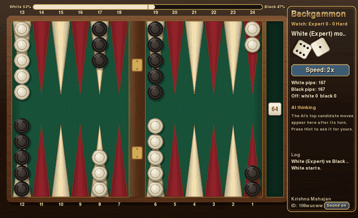
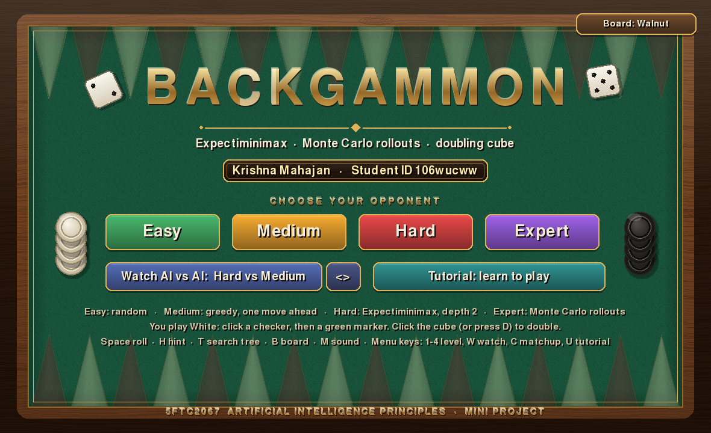
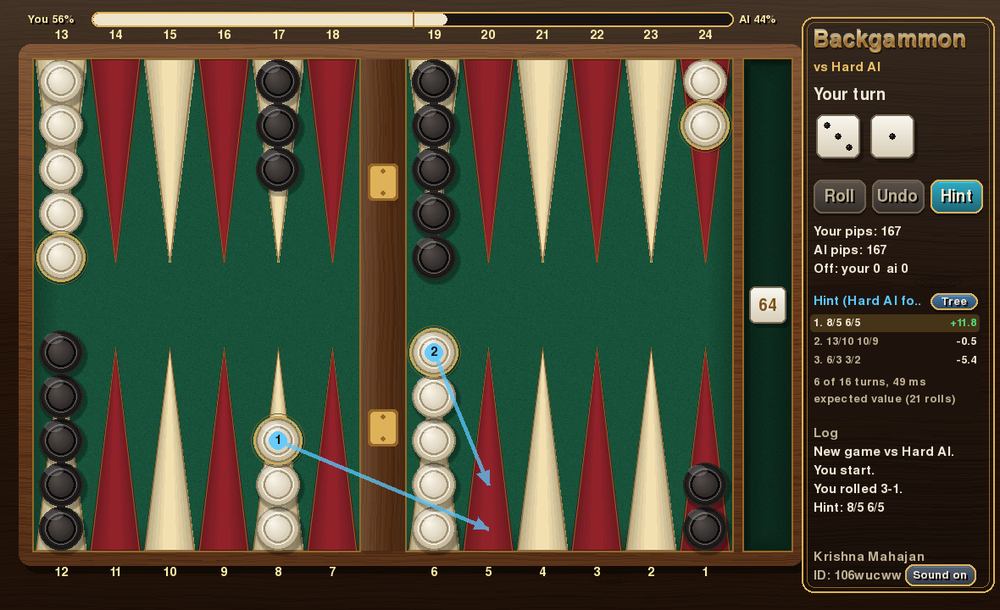
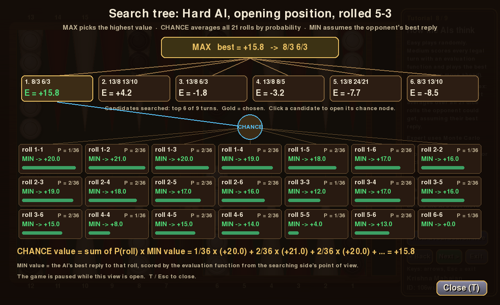
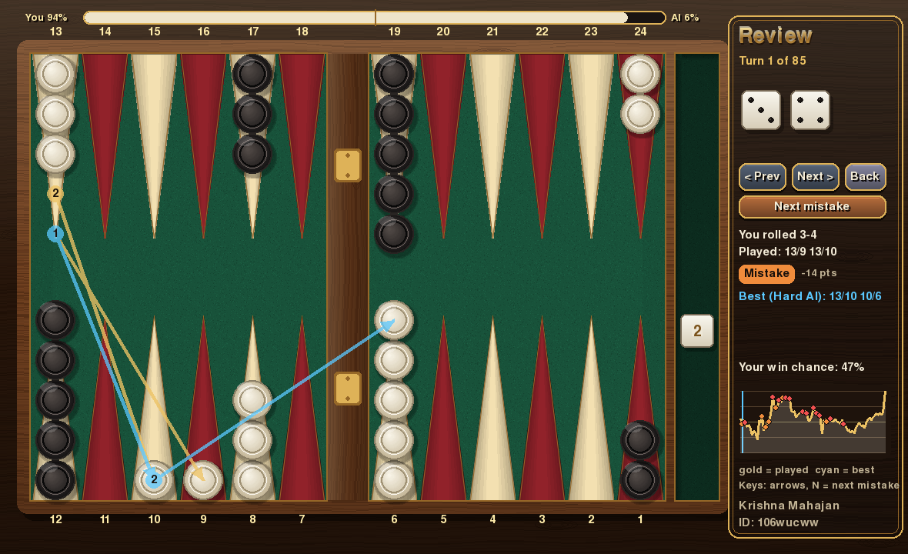
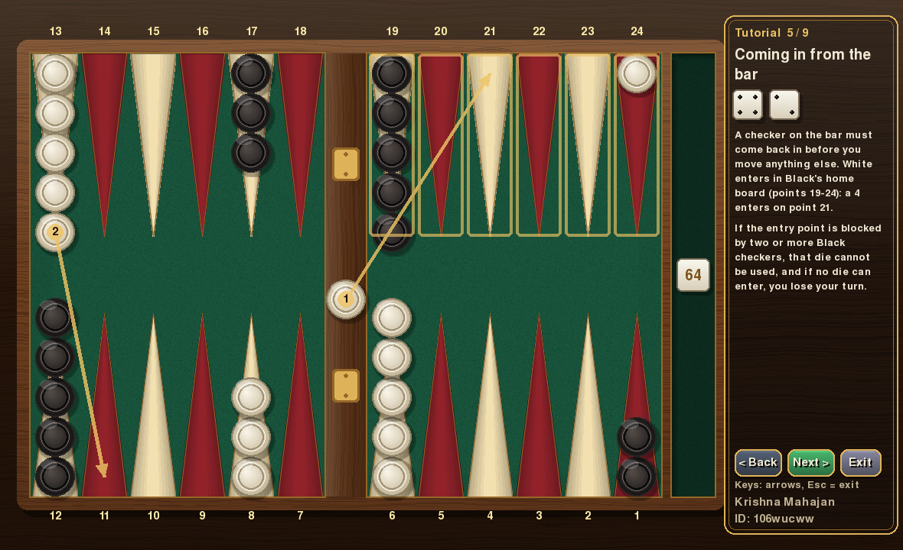

# Backgammon AI

**Krishna Mahajan · 106wucww** · 5FTC2067 Artificial Intelligence Principles, Mini Project
(University of Hertfordshire, delivered at PSB Academy, Singapore)

A full game of backgammon against four computer opponents built on two AI methods,
Expectiminimax search and Monte Carlo rollouts, with the doubling cube, a search-tree view
that shows how the AI decides, a game review, a tutorial and an AI-vs-AI watch mode.

**▶ Play it in your browser: [kris072008.itch.io/backgammon-ai](https://kris072008.itch.io/backgammon-ai)**



## The AI opponents

| Level | Method |
|---|---|
| Easy | Random legal moves |
| Medium | Greedy: scores every legal turn with a hand-written evaluation function (one move ahead) |
| Hard | **Expectiminimax**, depth 2: MAX over its turns, CHANCE over all 21 dice rolls, MIN over the opponent's best reply |
| Expert | **Monte Carlo rollouts**: 24 short simulated futures for each of its 6 best turns, scored by a calibrated win probability, with the same dice for every candidate |

The doubling cube uses the same win probability: an AI offers a double when its chance is
70–88% and accepts one at 25% or more (the standard take point).

## Results (2,100 AI-vs-AI games, 95% margins of error)

| Match | Games | First AI's win rate |
|---|---|---|
| Medium vs Easy | 100 | 100% |
| Hard vs Easy | 100 | 99% ± 2 |
| Hard vs Medium | 400 | 59% ± 5 |
| Expert vs Medium | 300 | 72% ± 5 |
| Expert vs Hard | 400 | 57% ± 5 |

Every game has its own seed, so `python3 experiments.py` reproduces these numbers exactly.
A mirror test also uncovered (and the fix removed) a hidden colour bias in how ties between
equally scored moves were broken.

## Screenshots

| | |
|---|---|
|  |  |
|  |  |



## Run it on your computer

```bash
pip install pygame-ce
python3 main.py
```

Controls: **Space** roll · **H** hint · **T** search tree of the AI's last move · click the cube
or **D** to double · **B** board set · **M** sound. On the title screen: **1–4** level,
**W** watch two AIs (**C** changes the matchup, **S** the speed), **U** tutorial.
After a game, **Review** steps through every turn with your move grades and the best moves.

## Tests and experiments

```bash
python3 -m unittest discover tests     # 19 tests: rules, scoring, win probability, all four AIs
python3 experiments.py --quick         # small version of the experiments
python3 experiments.py                 # the full 2,100 games (about 10 minutes, uses every core)
```

`experiments.py` needs `matplotlib` for its charts.

## Project structure

| File | What it does |
|---|---|
| `backgammon.py` | Rules engine: board, dice, legal turns, hitting, the bar, bearing off |
| `ai.py` | Evaluation function, Expectiminimax, Monte Carlo rollouts, win probability, cube decisions |
| `gui.py` | Pygame interface, tutorial, review, search-tree view, watch mode |
| `art.py` | All artwork drawn in code (wood, felt, checkers, dice, gold lettering), no image files |
| `main.py` | Entry point for the desktop and the browser build ([pygbag](https://pygame-web.github.io)) |
| `experiments.py` | Seeded AI-vs-AI experiments, run in parallel |
| `tests/` | Automated tests |

## Use of AI tools

AI assistance (Claude) was used to support code development, debugging and the explainer
animation, as stated in the project report.
